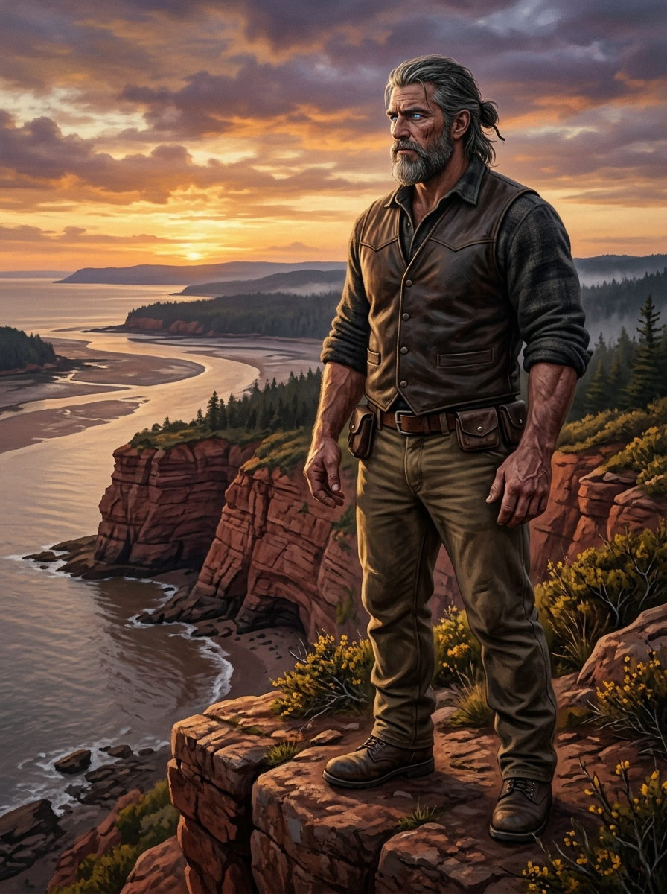
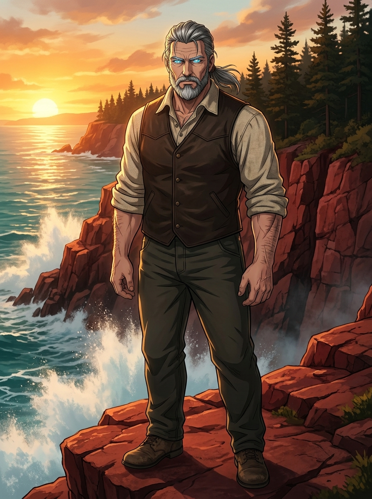
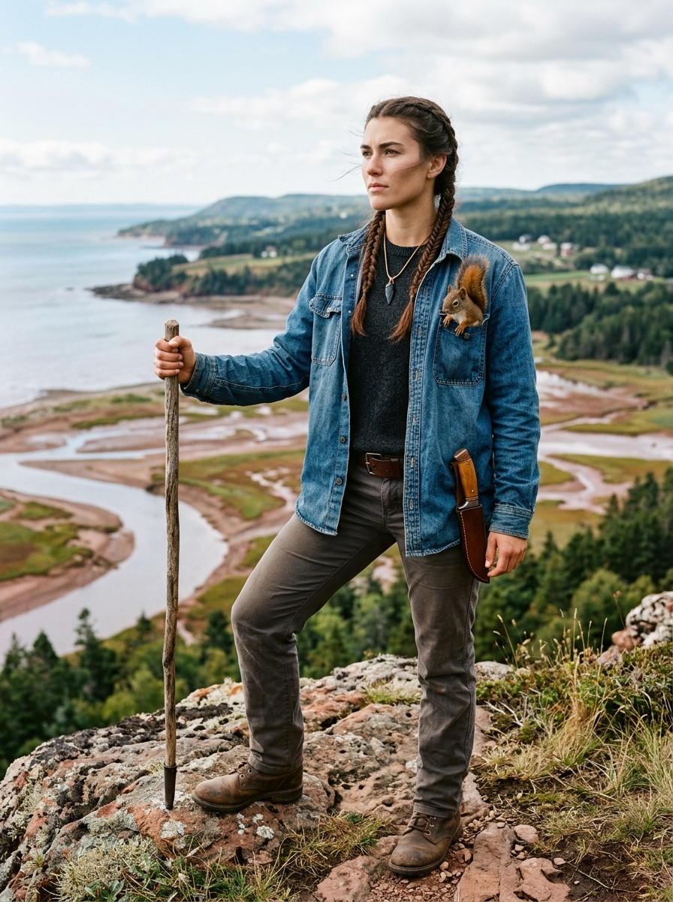
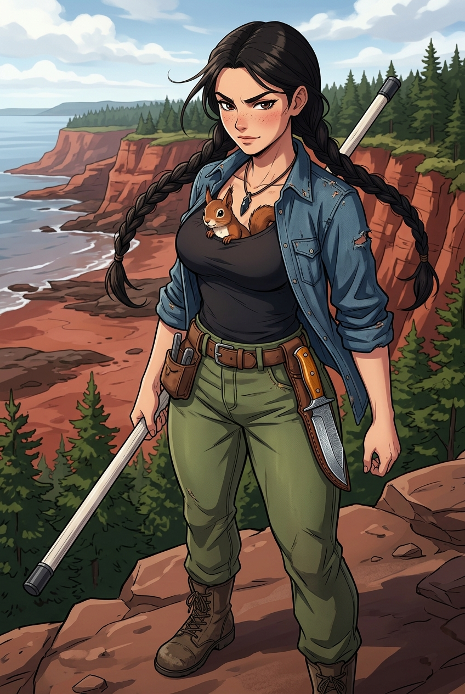

# The Petkotkweyak Chronicles — Master Character Cards

---

## 1. MAC — THE KINAP (*KWITN*)

*Realistic Concept Art: Mac standing on the red sandstone bluffs of the Bay of Fundy at golden hour.*

*Anime Key Visual: Mac channeling Mntu with azure-glowing irises, Seinen action aesthetic.*

### Quick Dossier
* **True L'nu Name:** *Kwitn* (Mi'kmaw for the deep ocean birchbark canoe engineered with high gunwales to ride forty-foot Fundy tidal breakers).
* **Common Alias:** Mac, The Old Man of the Bends, The Kinap.
* **Apparent Age:** Late 40s to early 50s (biologically ageless/timeless).
* **Physical Frame:** 6'2" (188 cm), ~235 lbs (106 kg). Massive, grounded logger's build; immense functional tendon and bone density without artificial bodybuilder hypertrophy.
* **Distinctive Features:** 
  * Weathered Maritime skin, strong square jaw, silver-streaked dark hair tied back in a low rawhide thong.
  * Neatly trimmed beard frosted with gray along the jawline.
  * Deep granite-gray eyes in everyday repose; ignites into brilliant, cold **electric azure blue** when channeling *Mntu*.
  * Massive, shovel-blade hands with heavy calloused knuckles and scarred palms.

---

### Biological & Kinap Anatomy (Supernatural Mechanics)
* **Situational Strength (Unteachable):**
  * Mac's strength scales instantaneously to match whatever task he sets his will to.
  * There are no straining veins, theatrical grunting, or energy auras. Whether casually hoisting an 800-lb granite hearthstone or halting a runaway 4-ton spruce log in a rushing tidal bore, his frame treats the mass as if gravity relaxed its grip.
* **Situational Invulnerability (Bulletproof by Will):**
  * Immune to ballistic and kinetic trauma the microsecond he decides to resist.
  * High-velocity rifle rounds, lead balls, buckshot, and shrapnel flatten or shatter against his skin and clothes like hail striking Mary's Point bedrock, dropping spent into the red silt.
* **Mntu Channeling (The Azure Gaze):**
  * Channels *Mntu* (the primordial spiritual power and vital energy of the land and tide) directly from the red Fundy bedrock.
  * High-output feats (30-foot leaps, kinetic shock absorption, lethal force) manifest as an incandescent electric azure glow in his irises.
* **Radiant Heat & Kinetic Sink:**
  * Immune to radiant forge heat and skin blistering; can grip red-hot tongs or anvil horns without tissue damage.
  * Channels kinetic recoil from his 32-lb sledgehammer strikes (2,400 Joules per blow at 80 bpm) straight through his skeletal column into the earth, preventing all lactic acid buildup and ligament shear.
* **Animal Communion (Teachable):**
  * Full two-way empathic and vocal telepathy with wildlife (wolves, bears, ravens, foxes). Can be taught through *Netukulimk* (sacred balance) and vocal breath grammar.

---

### The Sovereign Arsenal & Martial Discipline
* **Carried Weapons:** **None.**
* **Martial Discipline (The Master In-Fighter):**
  * Mac is no slouch in the pocket. Having survived centuries, he possesses elite, time-tested mastery of bare-knuckle pugilism, old-school classical boxing, dirty boxing, and indigenous close-quarters grappling.
  * **The High-Speed Figure-Eight Onslaught (The Kinetic Pendulum Barrage):**
    * When Mac commits to ending an unnatural or heavily armored threat, he lowers his hips and initiates a terrifying, high-cadence **figure-eight harmonic weave** ($\infty$). 
    * His head and shoulders dip and roll with blinding velocity—the air whistling past his ears like turbine blades as his 235-lb frame cuts through the wind. 
    * Opponents swing wild; their blades, bayonets, or frost-claws slice empty air as his head weaves beneath them. 
    * **The Exponential Kinap Escalation:** If an opponent possesses the supernatural density to tank the initial hits (such as the petrified frost-armor of a **Chenoo**), Mac does not reset or back away. Because a Kinap is as strong as he *needs* or *wants* to be in any given moment, Mac **willfully dials up the kinetic mass behind each alternating hook**:
      - *Strikes 1–2:* 2,500 Joules. Sounds like heavy sledges on hardwood; cracks surface permafrost.
      - *Strikes 3–4:* 8,000 Joules. The air screams; shockwaves blow the red mud off the flats in concentric rings.
      - *Strikes 5–6:* 25,000 Joules. Sounds like naval artillery firing point-blank; vapor cones condense around his bare fists as each blow breaks the local sound barrier in phone-booth distance.
      - *Strikes 7+:* Tectonic-level hydraulic devastation. The compound acceleration and exponential mass transfer buckle petrified bone, drive the monster's legs two feet deep into solid shale, and punch straight through frozen chest cavities to crush black ice hearts to steam. (Strictly in-universe Maritime physics; never named with meta terms).
  * **In-Fighting Prowess:** Slips punches by half an inch, works the collar-tie clinch, and delivers short, six-inch shovel hooks that deliver devastating kinetic shock straight into ribs and liver. Zero wild haymakers; pure technical precision, head movement, and devastating phone-booth violence.
* **The Absolute Lethality Rule:** Anyone who faces Mac with killing intent—anyone who comes to butcher Maya, slaughter the homestead, or murder—**does not live**. There are no half-measures, no cinematic speeches, and no rehabilitation for bloodthirsty warlords. Threats with lethal intent are put into the red silt with cold, final permanence.
* **The Post-Battle Exhaustion & Maya's Care:** Channeling exponential *Mntu* through the figure-eight roll exhausts his biological vessel. When the battle ends, Mac is completely, bone-wearily tired. This triggers a profound romantic role-reversal: Maya steps up to "baby" him—washing his scorched knuckles, tucking him into heavy wool blankets by the thermal hearth, feeding him rich hot stew, and keeping watch while the titan recovers. Scar curls on his chest as an eight-ounce heater.
* **Combat Cadence:**
  1. *Peaceful Arrival:* Open posture, loose palms, calm baritone voice offering intruders a peaceful retreat.
  2. *The Line Crossed:* Hostile racks a bolt, raises steel, or threatens Maya/the homestead.
  3. *The Inhale:* Deep, silent nasal breath pulling *Mntu* into his lungs and sinew.
  4. *The Azure Ignition:* Electric blue fire ignites in his irises.
  5. *Absolute Violence (The In-Fighter Unleashed):* Slipped punches, inside hooks, weapons caught by the blade, crowbars snapped like pine kindling, and threats ended with cold, technical, unstoppable finality.

---

### Personality, Philosophy & Voice
* **Scholar & Bibliophile:** Former archivist. Maintains the last great maritime library in the lighthouse tower (Johnson's 1755 OED, Champlain's 1613 *Voyages*, Vitruvius, Terry Pratchett).
* **Tone:** Warm, deadpan, self-amused, deeply pragmatic. Never pedantic in speech; communicates wisdom through dry wit and tactile demonstration.
* **Oaths:** Strictly secular/natural Maritime oaths ("By the salt and the shale", "By the tide"). Zero Abrahamic cursing.
* **Key Quotes:**
  * *"A tool doesn't know who owns it, Maya. It only knows if the hand holding it understands where the grain wants to split."*
  * *"Steel is honest. If you lie to it in the fire, it cracks on the quench to tell everyone you were in a hurry."*
  * *"The tide doesn't hate the mud it washes away. It just has somewhere to be twice a day."*

---

### Relationship to Maya
* **Sovereign Partners & Slow-Burn Romance:**
  * Strictly non-paternal. Mac treats Maya as an intellectual equal, a sovereign co-defender of the headland, and an adult companion.
  * Shared labor at the forge, quiet vigilance in the high lantern room, and mutual vulnerability foster an intense, unspoken romantic attraction.

---
---

## 2. MAYA — THE ENGINEER OF THE RED MUD

*Realistic Concept Art: Maya on the Fundy bluffs with white ash staff, Damascus knife, and Scar.*

*Anime Key Visual: Maya with exaggerated anime proportions, twin herringbone braids, and Scar snuggled in her neckline.*

### Quick Dossier
* **Full Name:** Maya (Acadian heritage, Moncton native).
* **Aliases:** The Engineer of the Red Mud, The Sovereign Runner.
* **Age:** 24 years old.
* **Background:** Former Dalhousie University mechanical engineering student and competitive varsity track athlete (sprinter and hurdler). Escaped brutal enslavement in Sussex before collapsing on the Petitcodiac mudflats.
* **Physical Frame:** 5'9" (175 cm), ~145 lbs (66 kg).
  * Highly athletic runner's physique: sculpted shoulders, long powerful quadriceps, exceptional fast-twitch explosive speed.
  * Unmistakably generous, curvaceous proportions (accentuated with dramatic hourglass silhouette in anime styling).
* **Distinctive Features:**
  * High Acadian cheekbones, sharp determined jawline, dark chicory-brown eyes brimming with spatial calculation.
  * Long dark brunette/black hair styled into two practical, tight herringbone twin braids resting over her collarbones.
  * Healing scars on wrists and ankles from Sussex chain-gang irons, treated with Mac's herbal salves.

---

### The Four-Tier Combat Arsenal (Crafted with Mac)
1. **The Seasoned White Ash Staff (5' 2"):**
   * *Material:* Straight-grain white ash (*Fraxinus americana*), hand-scraped, oiled with raw linseed and beeswax.
   * *Hardware:* Cold-forged iron ferrule cap with hardened steel cross-pin.
   * *Role:* Kinetic distance control, sweeping legs, shattering knee joints, and securing doorways. Owns an unbreachable 6-foot perimeter.
2. **The 320-Layer Damascus Drop-Point Fighter (6.5" Blade):**
   * *Metallurgy:* Hand-welded billet combining 1910 Nicholson farrier's rasp (1095 crucible carbon steel) + locomotive leaf spring (5160 Cr-Mn steel) + Swedish charcoal iron.
   * *Blade Geometry:* 320 micro-layers, differential clay-jacket temper (*hamon* line), 63 HRC glass-hard edge backed by a shock-absorbing 52 HRC spine.
   * *Handle & Sheath:* Heritage golden applewood scales contoured to Maya's palm arches; cold-peened copper bus-bar rivets; wet-formed, hot-waxed (*cuir bouilli*) caribou sheath with copper welt, worn at a 20° forward cant on her right hip.
3. **The Molecular Scalpel / Obsidian Neck Razor (3" Leaf):**
   * *Material:* High-grade Pacific Northwest volcanic glass (*Kekwet*), pressure-flaked with moose antler and copper billet to a 3-nanometer edge (30 Angstroms / single molecular chains of silica).
   * *Hilt & Suspension:* Split white cedar handle secured with charcoal-tempered spruce pitch, clamped by boiled deer sinew, sealed in balsam rosin. Worn flat over her sternum beneath her shirt on a thin rawhide cord.
   * *Role:* Emergency hideout weapon. Cuts on a cellular level without crushing nerve sheaths, bypassing textile resistance.
4. **The Retreat Covenant:**
   * Tactical realism: If faced with three or more armed opponents or rifle fire from timber, Maya drops bravado and runs straight to Mac.

---

### Companion: Scarlet ("Scar") — The Red Squirrel
* **Species:** Acadian Red Squirrel (*Tamiasciurus hudsonicus*).
* **Weight:** 8 ounces of concentrated cheek, territorial fury, and chittering indignation.
* **The "Bra-Squatter" Tenant:**
  * Decided Maya's fleece-lined sports bra and generous bustline are the warmest, five-star luxury real estate in eastern Canada.
  * Rides curled against her skin, poking his tufted russet head, dark eyes, and whiskers out of her open collar.
  * Serves as Maya's early-warning proximity alarm, growling at strangers and flicking his bushy tail.

---

### Engineering Mindset & Psychology
* **Mechanical Lens:** Analyzes every physical phenomenon through engineering principles:
  * Calculates torque on lumbar vertebrae, moment arms, shear stress on rivets, and Joules of kinetic impact.
  * Spark-spectroscopy testing to identify carbon content in salvaged railway steel.
* **Psychological Arc:** Transforms from a traumatized, cornered runaway into a confident, sovereign co-builder of the homestead. Fiercely protective of Mac and the sanctuary.
* **Voice & Wit:** Sharp, analytical, pragmatic, and affectionate. Often dryly calculating Mac's "impossible" physics out loud.
* **Key Quotes:**
  * *"A four-hundred-pound timber dropped from six feet is three thousand foot-pounds of torque. You didn't even bend your knees, Mac. What is your spine made of?"*
  * *"If Sussex comes up this river, they aren't finding a runaway. They're finding a fortified battery and two people who know the tide."*
  * *"Get down, Scar. You're an eight-ounce rodent, not a gargoyle."*

---
---

## 3. SUPPORTING WILDLIFE COMPANIONS

### Nipn ("Summer") — The Eastern Timber Wolf
* **Species:** Eastern Timber Wolf (*Canis lupus lycaon*).
* **Size:** 130 lbs, silver-grey coat, piercing golden-amber eyes.
* **Role:** Homestead scout, perimeter tracker, Mac's intellectual equal in forest tactics.
* **Temperament:** Stoic, dignified, possesses deadpan canine comedic timing. Tolerates Scar's scolding with philosophical resignation.

### Ursus — The Fundy Bear (Beggar Bear & Shoreline Guard)
* **Species:** Atlantic Black Bear (*Ursus americanus*).
* **Size:** 450 lbs, sleek black fur with a white crescent patch on chest.
* **Role:** Shoreline deterrent to river raiders and tidal flat sentry.
* **Personality:** Playful, passionate lover of shad and wild blueberries. Wrestles with Mac for recreation and sleeps through Fundy blizzards in a custom stone den lined with patchwork wool.

### Wojkw ("Fox") — The Perimeter Scout
* **Species:** Eastern Red Fox (*Vulpes vulpes*).
* **Role:** Rodent control and silent night-watch sentry along the living-wood palisade.
* **Quirk:** Curls around Mac's neck like a living scarf on sub-zero autumn dawns.
